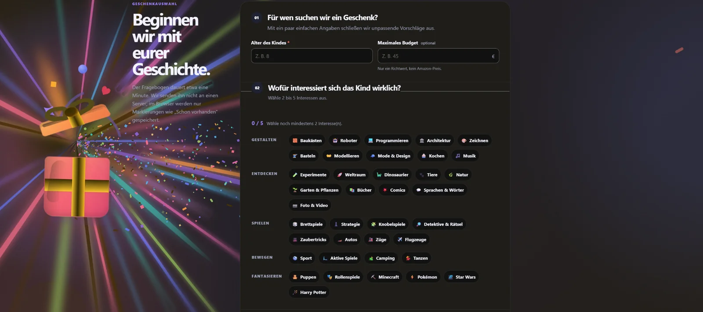
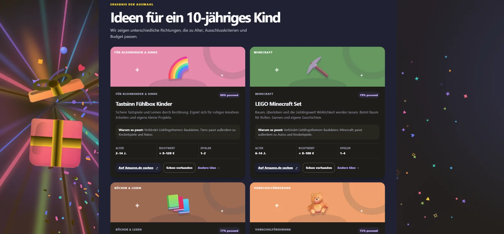

# Geschenk? – Interaktiver Geschenkfinder für Kinder

[**Live-Demo öffnen**](https://dmytro-moldovanu.github.io/Geschenk-/) · [**Quellcode ansehen**](https://github.com/Dmytro-Moldovanu/Geschenk-) · [**Lokal starten**](#lokal-starten)

**React 19 · TypeScript · JavaScript · HTML5 · CSS3 · Vite · Vitest · GitHub Pages**

> **Portfolio-Projekt:** Geschenk? ist eine interaktive Webanwendung, die anhand persönlicher Interessen und klarer Ausschlusskriterien passende Geschenkideen für Kinder ermittelt. Der Fokus liegt auf nachvollziehbarer Filterlogik, einer vielfältigen Datenbasis und einer responsiven Benutzeroberfläche.


## Projektüberblick

Wer ein Geschenk für ein Kind sucht, kennt häufig dessen Interessen, aber nicht das passende Produkt. Einfache Listen nach Altersgruppe liefern oft ähnliche oder unpassende Vorschläge. Diese Anwendung übersetzt die Angaben in eine **individuelle Auswahl von bis zu fünf unterschiedlichen Geschenkideen** und erklärt, warum die Vorschläge passen.

Die Demo arbeitet vollständig im Browser mit einem lokalen Katalog aus **360 Geschenkideen in 36 Kategorien**. Sie benötigt weder ein eigenes Backend noch einen Amazon-API-Zugang. Produktrecherchen erfolgen über konkrete Suchbegriffe auf Amazon.de; der Kauf selbst findet ausschließlich außerhalb der Anwendung statt.

## Ein Rundgang durch die Anwendung

Die Website ist als **Single-Page-Anwendung** aufgebaut. Die nachfolgenden Bereiche werden beim Scrollen nacheinander sichtbar; es handelt sich nicht um vier getrennte Unterseiten.

### 01 – Startseite: Idee und Einstieg


Die Startseite erläutert das Konzept: keine zufällige Geschenkeliste, sondern eine Auswahl auf Grundlage der Angaben über das Kind. Das zweigeteilte Layout kombiniert eine kompakte Einführung mit einer farbigen Illustration rund um die Geschenkbox und verschiedene Themenbereiche. Die Gestaltung passt sich an unterschiedliche Bildschirmgrößen an.

### 02 – Angaben und Interessen



Zunächst wird das **Alter** abgefragt, optional kann ein **maximales Budget** angegeben werden. Danach werden **zwei bis fünf Interessen** ausgewählt, beispielsweise Bauen, Robotik, Lesen, Musik, Natur, Sport oder Brettspiele. Die Interessen sind thematisch gruppiert und bilden die Grundlage für das spätere Ranking.

Die Formularvalidierung weist sichtbar auf fehlende Pflichtangaben, eine ungültige Altersangabe, ungeeignete Budgetwerte und eine unzulässige Anzahl an Interessen hin. Der Fokus wird auf das zu korrigierende Feld gelenkt.

### 03 – Persönliche Ausschlusskriterien


Im dritten Bereich wird die Auswahl weiter eingegrenzt. Nutzerinnen und Nutzer können unter anderem angeben:

- für wie viele Personen ein Geschenk geeignet sein soll;
- ob Produkte mit großen Bildschirmen, laute Spielzeuge, Gewaltthemen oder Kleinteile ausgeschlossen werden sollen;
- welche Geschenke bereits vorhanden sind;
- welche Kategorien oder Produkte nicht in Frage kommen.

Diese Kriterien sind **feste Filter**: Ungeeignete Vorschläge werden vor der Bewertung ausgeschlossen und nicht nachträglich als scheinbar passende Treffer ausgegeben.

### 04 – Ergebnis: begründete Geschenkempfehlungen



Nach dem Absenden erscheinen bis zu **fünf unterschiedlich ausgerichtete Geschenkvorschläge**. Jede Karte zeigt eine Kategorie, die konkrete Geschenkidee, eine Beschreibung, eine berechnete Übereinstimmung, die Altersspanne, einen geschätzten Preisbereich und die geeignete Spielerzahl.

Eine kurze Begründung erklärt, welche Interessen des Kindes berücksichtigt wurden. Mit **„Schon vorhanden“** wird ein Vorschlag ausgeschlossen; **„Andere Idee“** liefert eine Alternative. Die Schaltfläche **„Auf Amazon.de suchen“** öffnet eine konkrete Produktsuche in einem neuen Tab.

> Die Prozentanzeige ist eine Bewertung des **eigenen Matching-Algorithmus** und keine statistisch garantierte Erfolgswahrscheinlichkeit. Preisangaben sind Katalogrichtwerte, keine Live-Preise von Amazon.

## Technische Umsetzung

| Bereich | Technologie / Umsetzung |
| --- | --- |
| Benutzeroberfläche | **React 19**, **TypeScript**, semantisches **HTML5** |
| Gestaltung | **CSS3**, responsive Layouts, Übergänge und Scroll-Animationen |
| Entwicklungsumgebung | **Vite** für Entwicklungsserver und Produktions-Build |
| Datenmodell | Lokaler, typisierter Geschenkekatalog mit Kategorien, Interessen und Merkmalen |
| Empfehlungssystem | Filter-, Scoring- und Diversifizierungslogik in **TypeScript** |
| Browser-Speicherung | **localStorage** für als vorhanden markierte Geschenke |
| Tests | **Vitest** für Datenkonsistenz, Empfehlungslogik und Speicherung |
| Qualitätssicherung | **Oxlint** sowie TypeScript-Prüfungen |
| Bereitstellung | Statische Veröffentlichung über **GitHub Pages** |

### Ablauf des Empfehlungssystems

1. **Eingaben prüfen:** Pflichtfeld Alter, Auswahl von 2–5 Interessen und gültige Werte kontrollieren.
2. **Harte Filter anwenden:** Alter, Budget, Spielerzahl, Produkteigenschaften und bereits vorhandene oder ausgeschlossene Geschenke berücksichtigen.
3. **Übereinstimmung berechnen:** Direkte und verwandte Interessen bewerten; passende Geschenke sortieren.
4. **Vielfalt sicherstellen:** Ähnliche Vorschläge begrenzen, damit die Ergebniskarten möglichst unterschiedliche Geschenkarten zeigen.
5. **Ergebnisse interaktiv anpassen:** Ausgeschlossene oder ersetzte Vorschläge unmittelbar durch weitere passende Ideen ersetzen, soweit verfügbar.

Werden durch die festen Filter zu wenige Produkte gefunden, ergänzt das System **keine zufälligen Treffer**, sondern gibt Hinweise auf mögliche Anpassungen der Kriterien.

### Amazon.de ohne API

Die Geschenke stammen aus dem internen Katalog. Für jeden Eintrag ist ein **konkreter deutschsprachiger Suchbegriff** hinterlegt, beispielsweise eine Produktserie oder ein genauer Geschenktyp. Daraus wird ein Amazon-Suchlink erzeugt:

```ts
const url = `https://www.amazon.de/s?k=${encodeURIComponent(amazonSearchQuery)}`
```

Das System liest keine Preise oder Verfügbarkeiten von Amazon aus. Die tatsächlichen Suchergebnisse werden auf der Website von Amazon angezeigt und können sich verändern.

### Interaktive Hintergrundanimation

Der Hintergrund nutzt bewegte Illustrationen und eine an die Scrollposition gekoppelte Geschenkanimation. Ergänzend werden Lichtstrahlen, Farbstreifen und Konfetti dargestellt. Die Effekte sind von der eigentlichen Empfehlungslogik getrennt. Auf der Startseite wird die goldene Geschenkbox als transparente PNG-Datei eingebunden.

## Projektstruktur

```text
.
├── src/
│   ├── components/       # Formular, Empfehlungen und animierter Hintergrund
│   ├── data/             # Geschenkkatalog, Kategorien und Interessen
│   ├── engine/           # Empfehlungssystem, Amazon-Links, lokale Speicherung
│   └── tests/            # Automatisierte Tests
├── public/               # Statische Assets der Entwicklungsfassung
├── docs/                 # Fertige GitHub-Pages-Version
├── screenshots/          # Screenshots für die Projektdokumentation
├── scripts/              # Build- und Kompatibilitätsskripte
├── WEBSEITE_OEFFNEN.html # Eigenständige Offline-Demo
├── package.json
└── README.md
```

Die Ordner `src/` und `docs/` haben unterschiedliche Aufgaben: **`src/`** enthält den wartbaren Anwendungsquellcode, **`docs/`** die bereits vorbereitete Website für GitHub Pages. Die Offline-Datei ist eine zusätzliche Möglichkeit, das Projekt ohne Installation anzusehen.

## Lokal starten

Voraussetzung: **Node.js 22** oder eine kompatible neuere Version und npm.

```bash
npm ci
npm run dev
```

Anschließend die von Vite angezeigte lokale Adresse öffnen (normalerweise `http://localhost:5173/`).

Weitere Befehle:

```bash
npm test             # Tests ausführen
npm run lint         # Code prüfen
npm run build        # Produktionsversion in dist/ erstellen
npm run build:pages  # GitHub-Pages-Dateien in docs/ aktualisieren
```


**Live-Demo:** [https://dmytro-moldovanu.github.io/Geschenk-/](https://dmytro-moldovanu.github.io/Geschenk-/)

## Hinweise zum Projekt

Dieses Projekt dient ausschließlich der **technischen Demonstration im persönlichen Entwicklerportfolio**. Es ist **kein Shop**: Es gibt weder eine Bestellfunktion noch eine Zahlungsabwicklung. Produktnamen und Marken dienen nur der Beschreibung passender Geschenkideen. Amazon ist kein technischer Partner des Projekts; die Links führen lediglich zu externen Suchergebnissen. Alle gezeigten Schätzpreise sind unverbindliche Katalogwerte.
